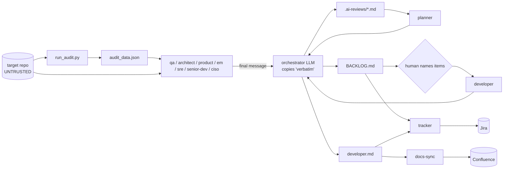

# Skills & Roles Audit — October 2026

A full audit of every skill, role agent, command, the `ai-sync` generator, the helper scripts,
tests and CI, as of `5628b27`. Each bug listed under **Bugs** was reproduced by running the code
in a scratch project, not inferred from reading it. Everything else is a judgment call, and the
reasoning is given next to it.

**Scope note.** `ogen-ai` has no GUI, no server, no database and no end users in the app sense.
It's a CLI generator (`bin/ai-sync`) plus a library of markdown prompts and four stdlib Python
scripts. The questions about GUI, heavy traffic, data storage and mobile porting are answered
in §8 for what this repo actually is, without inventing a web app it doesn't have.

---

## 1. Executive summary

**Strengths.** The design is unusually disciplined. Tool grants serve as the enforcement
mechanism (`ciso`/`planner` have no Bash at all). A human-approval gate sits in front of the
only code-writing role. Generated docs are CI-checked for drift. Actions are SHA-pinned. The
per-platform sourcing is documented honestly, and the generator follows a stdlib-only rule.
133 tests pass on Python 3.13.

**The five things to fix first:**

| # | Severity | Item |
|---|---|---|
| 1 | **critical** (security) | `/role-review <git-url>` makes `qa` **run an untrusted repo's test suite** on the user's machine, and six reviewers hold unrestricted Bash while reading attacker-controlled text (README, code comments). This is arbitrary code execution plus a prompt-injection-to-exfiltration path. It contradicts the "a security review that executes it has already lost" stance that `ciso` was built on. |
| 2 | **high** (data loss) | `ai-sync` **silently overwrites a hand-written `AGENTS.md`** and any hand-written file at a ported-command/agent path (e.g. `.github/prompts/review.prompt.md`), with no `--force` needed. This breaks the "never clobber without `--force`" invariant that `CLAUDE.md` promises. |
| 3 | **high** (correctness) | `tracker`'s idempotency marker embeds `<sha>` and a finding ID that `role_review` **renumbers on every run**. Every re-review therefore produces new markers, and **duplicate Jira tickets** follow. |
| 4 | **high** (portability) | `tracker`/`docs-sync` hard-code `mcp__atlassian__*`. In this very session the connected Atlassian server is named `Atlassian_Rovo` (tools are `mcp__Atlassian_Rovo__createJiraIssue`, …), so both agents would have **zero working Jira/Confluence tools** out of the box. |
| 5 | **high** (UX) | Skills, commands and agents are linked as **whole directories**. A project that already has its own `.claude/skills/` gets *none* of the shared skills (skipped with a warning). With `--force`, the project's own skills are **deleted** (`rmtree`). Shared and project-local skills can't coexist. |

---

## 2. Bugs (reproduced)

| ID | Where | Bug | Repro |
|---|---|---|---|
| B1 | `bin/ai-sync:843` → `write_file` | Hand-written `AGENTS.md` overwritten unconditionally | `echo "# mine" > AGENTS.md && ai-sync` → banner file replaces it, no warning |
| B2 | `bin/ai-sync` `emit_*` (all 8 ports) | Ported files overwrite same-named hand-written files (`write_file` has no ownership check, unlike `place_file`) | Hand-written `.github/prompts/review.prompt.md` replaced with `copilot_commands = true` |
| B3 | `bin/ai-sync:138` | `languages = "python"` (string, not list) iterates characters, giving 6 bogus warnings `no such language fragment: p`, `y`, … | Manifest with a string value |
| B4 | `bin/ai-sync:115` | Malformed TOML gives a raw `tomllib.TOMLDecodeError` traceback instead of an actionable message | `echo "[stack" > ai-config.toml` |
| B5 | `bin/ai-sync` `rel_symlink` | Existing real `.claude/skills/` means all shared skills are skipped; `--force` runs `rmtree` on the project's own skills | See §1 #5 |
| B6 | `bin/ai-sync` (all ports) | **No orphan cleanup.** A command/agent removed or renamed upstream leaves its stale port forever. Dropping a target from `targets` leaves its links behind | By inspection; no removal path exists |
| B7 | `run_audit.py` `TestingAnalyzer` | A Go/Rust/Kotlin/Swift repo reports **"No source or test files detected" (high) with a Testing score of 100/100**: the finding and the score contradict each other, and `_test.go` files are never recognised | Two-file Go repo with `main.go` and `main_test.go` |
| B8 | `run_audit.py` `_add_edge_if_match` | Import-cycle detector matches on string suffix: `import os` creates an edge to any module ending in `os` (e.g. `pkg.zzz_os`). **False cycle reproduced:** `pkg.zzz_os -> pkg.repos -> pkg.zzz_os` where `repos.py` only does `import os` | Scratch repo |
| B9 | `run_audit.py` `_add_edge_if_match` | …and the reverse: `from pkg import repos` (the most common idiom) never produces an edge, because only `node.module` (`"pkg"`) is matched and the imported names are ignored. Real cycles are missed | Scratch repo |
| B10 | `run_audit.py` `RepoScanner.scan` | **Follows symlinks out of the target repo.** A cloned repo with `Dockerfile -> ~/.aws/credentials` gets that file read and scanned, and `ciso` is then told to "verify each hit by reading it". A FIFO or `/dev/zero` link named `Dockerfile` hangs the scan | `ln -s ../outside_secret.txt Dockerfile`: AWS-key finding reported from the outside file |
| B11 | `commands/claude/role.md` step 3 | Audit freshness is judged by comparing `generated_at` to the HEAD commit *time*. Check out an older commit after an audit and the stale audit looks fresh. `audit_data.json` doesn't record the sha it scanned | By inspection |
| B12 | `run_manifest.py` | Non-atomic read-modify-write of `manifest.json`. `/role-review` step 5 has the orchestrator call `--record` once per role, and agents often issue those Bash calls **in parallel**, so updates can be lost. A crash mid-write yields a corrupt file, which `load_manifest` replaces with an *empty* ledger, losing all history silently | By inspection |
| B13 | `run_manifest.py` `archive_run` | The sha comes from `manifest.json` and is used unvalidated as a path component (`archive/<sha>`). A target repo that *commits* a `.ai-reviews/manifest.json` with `"sha": "../../x"` can make `--begin` move files outside `.ai-reviews/` | By inspection |
| B14 | `run_manifest.py` `status` | Not a git repo means both sides are `"unknown"`, so it reports **"current"** forever. A short-sha length mismatch (`core.abbrev`) causes false STALE | By inspection |
| B15 | `skills/*/SKILL.md` | 4 skills have `name` ≠ directory (`audit_repo`↔`audit-repo`, `customize_config`, `repo_tree`, `role_review`). The Agent Skills spec requires them to match, and stricter loaders (Codex, Copilot) may reject or mis-key them | Frontmatter vs dirname check |
| B16 | `commands/claude/review.md`, `test.md` | `/review` likely collides with Claude Code's built-in `/review`; `/test` is generic enough to collide too. Users may silently get the other one | — |
| B17 | `skills/customize_config/init_config.py:48` | Comment says weights will be used "once wired up"; they have been wired up in `run_audit.py` for a while. Stale comment | — |

Minor: `apply_local_only` drops every line after a BEGIN marker whose END was hand-deleted.
`ScalabilityAnalyzer` reports one blocking call once per enclosing loop.

---

## 3. Skills — keep / update / merge / delete

| Skill | Verdict | Pros | Cons / what to change |
|---|---|---|---|
| `role_review` | **Keep (core)** | One schema, severity scale and budget for all reviewers is what makes the planner's dedupe possible | Step 4 "renumber IDs" makes IDs unstable across runs (feeds B-tracker). Add a stable **fingerprint** per finding (`hash(role, file, rule)`). Add an evidence-masking rule for *all* roles, not just `ciso` (see §6). Rename dir → `role-review` |
| `repo_tree` | **Keep (best in repo)** | Generated, CI-checked, tested (23 tests), honest null-vs-false staleness | Rename dir → `repo-tree`. Don't follow tracked symlinks out of the repo when deriving notes |
| `audit_repo` | **Keep, major update** | Good split between mechanical scan and judgment; confidence levels are honest; hardened against XML DoS | 1,129-line single file (its own god-file rule flags it). Python/TS only, even though the rules ship Go/Rust/Kotlin/Swift (B7). Cycle detector is wrong in both directions (B8/B9). Follows symlinks (B10). No sha stamp (B11). Thin secret patterns (no `ghp_`, `AIza`, `sk_live_`, JWT). **2 tests for 1,129 lines.** Split it into a package: scanner, one module per analyzer, CLI |
| `customize_config` | **Merge into `ai-config.toml`** | Clean parse/render/IO separation | A *third* config file (`ai-config.toml`, `ai-config.local.md`, `ai-project-config.toml`) is the main source of setup confusion. Only `audit_repo` reads it, and its parser is duplicated in `run_audit.py`. Move `[audit.weights]` and `[rules.custom]` into `ai-config.toml`, keep one parser, delete `init_config.py`. Currently **zero tests** |
| `lesson-capture` | **Keep** | Turns corrections into durable rules; good guard against silently editing shared `rules/` | Could auto-trigger on mild pushback; the "ask if ambiguous" rule mitigates that |
| `write-design-doc` | **Keep** | Same checklist as `architecture.md` and `architect`; doc/design modes are clearly split | — |
| `add-logging` | **Keep, trim** | Concrete, cross-language | Logging guidance is now stated in 3 places (`python.md` etc., `architecture.md`, this skill). Have the skill point at the rule instead of restating it |
| `conventional-commit` | **Keep** | Small, correct | Overlaps `git-commits.md`; acceptable |
| `release-checklist` | **Keep, dogfood** | Never pushes, stops on red gates | This repo has **no tags and no CHANGELOG**, so it doesn't use its own skill (see §7) |
| `scaffold-python-service` | **Keep, add a test** | Strict baseline, logging from day 1 | Nothing verifies that the template passes `ruff`/`mypy --strict`/`pytest`, even though the skill promises it does. Template deps are unpinned and not covered by Dependabot |
| `port-module-to-ts` | **Generalize or delete** | Strict behavior-parity rules | Very narrow (JS/Py→TS only). Make it `port-module <src> <lang>` so it reuses the language fragments, or drop it |

**Missing skills worth adding:** `debug-root-cause` (reproduce → bisect → failing test →
fix), `dependency-upgrade` (changelog read, lockfile, gate run), `threat-model` (STRIDE on a
design doc, pairs with `write-design-doc`), `pr-description`, and `db-migration-safety`
(backward-compatible migrations; `sre` already checks for this but nothing helps you write one).

---

## 4. Roles (agents) — keep / update

| Role | Model | Verdict | Pros | Cons / what to change |
|---|---|---|---|---|
| `ciso` | opus | **Keep (strongest)** | No Bash is a structural guarantee; masks secrets; never writes PoCs | Promises "secrets in source **or history**" but can't run `git log` without Bash. Have the orchestrator pre-compute a history secret scan into `audit_data.json`. Add modern token patterns |
| `architect` | opus | **Keep** | Judges against the repo's own scale; treats over-engineering as a finding too | Relies on the broken cycle detector (B8/B9). Its "verify before reporting" rule mitigates it, but the input should be fixed |
| `planner` | opus | **Keep** | Reads reports, not code; dedupe rules are explicit (SEC/SRE seam, SDR/QA seam) | Has to trust that the orchestrator copied reports "verbatim". An LLM transcribing 7 reports can drift (see §5) |
| `senior-dev` | opus | **Keep** | Requires a concrete triggering input for every correctness finding | Overlaps `/review` and audit Clean Code; lanes are well fenced, fine |
| `developer` | opus | **Keep** | Named-item approval gate, clean-tree requirement, failing-test-first, never commits | Open item #2 in CLAUDE.md (opt-in commit) is still reasonable to add |
| `qa` | sonnet | **Keep, fix the security hole** | "Would these tests catch a regression" is the right question | **Runs the target's suite** (§1 #1). Only run it for a local path the user owns, or inside a no-network container; for URL targets, report without executing |
| `sre` | sonnet | **Keep, remove Bash** | Excellent scope discipline ("never walk `src/`") | Its Bash is only for `git log`. Have the orchestrator pass git metadata in and withhold Bash like `ciso`, which settles CLAUDE.md open item #1 |
| `engineering-manager` | sonnet | **Keep, remove Bash, consider haiku** | Cheapest role, metadata only | Same as `sre`: the orchestrator can supply `git log`/`shortlog` output. A cheaper model fits the work |
| `product` | sonnet | **Keep** | Doc-claim vs code-surface cross-check is high value | `--help` execution on the target is code execution; same gate as `qa`. Add an accessibility/UX lens for repos that ship a UI (React rules exist; no role reviews a11y) |
| `docs-sync` | sonnet | **Keep, tighten** | Asks before *creating* Confluence pages; empty sync is a valid result | Updates existing Confluence pages **without confirmation** while holding Bash + Write and reading untrusted repo text, a prompt-injection-to-publish path. Show a diff and confirm before any external write. Fix the MCP alias (§1 #4) |
| `tracker` | sonnet | **Keep, fix idempotency** | No Bash; refuses to fabricate; never auto-closes | Duplicate tickets (§1 #3) and the alias (§1 #4). Use a **content fingerprint** marker, not `<sha>` + renumbered ID |

**Missing roles to consider:** `privacy` (PII flows, retention, GDPR/consent, logging of
personal data; `ciso` covers secrets but not data protection), `performance` (hot paths,
N+1, allocation; `audit_repo` Scalability is a weak proxy), and `frontend/a11y` for UI repos.
Don't add `mobile` until there's a consumer that needs it, since the Kotlin/Swift rule fragments
already cover code style.

**Cost note.** A full `/role-review` launches 7 agents (4 on opus) and then the opus planner.
Document a rough token cost in the README and make `--roles` subsets more prominent.

---

## 5. Data flow

Weak points:

1. **The orchestrator is a lossy copier.** Reports go from subagent output to disk through an
   LLM told to write them "verbatim". Long reports can be truncated or paraphrased, and nothing
   detects it. Persist deterministically instead: a `SubagentStop` hook, or have each reviewer
   return its report and a script write it, then validate it against the `role_review` schema
   (a small `validate_report.py` that checks section order, ID prefixes, severities and
   `file:line` shape).
2. **Manifest bookkeeping depends on the LLM following steps 2–6**, and nothing checks that it
   did. A `run_manifest.py --verify` that confirms every launched role has a recorded report
   would catch skipped steps.
3. **Pre-planted `.ai-reviews/`.** If the target repo *commits* `.ai-reviews/` (BACKLOG, reports,
   manifest), the commands consume attacker-supplied content as if it were their own output.
   Refuse to run when `git ls-files .ai-reviews` is non-empty.
4. **No feedback loop.** Nothing re-runs the source finding after `developer` to confirm it's
   resolved. Add `/role-verify <items>` that re-runs only the originating role on the cited files.

---

## 6. Security (beyond the bugs)

- **Execution of untrusted code** (§1 #1) is the top issue. Options, best first: (a) run the
  fan-out inside a devcontainer/sandbox with no network and no host credentials; (b) for URL
  targets, strip Bash from every reviewer and pass all git/CI metadata in from the orchestrator;
  (c) at minimum, have `qa`/`product` refuse to execute anything for URL targets.
- **Prompt injection.** Six roles read attacker-controlled text and hold Bash. The deny list in
  `adapters/claude-agent-permissions.json` blocks commits and installs but **not
  exfiltration**: `curl`, `wget`, `nc`, `python -c`, `node -e`, `ssh`, `scp` and `git push`
  via alias are all allowed. Add those. Also note that the deny list is project-wide and
  hand-merged, so most users won't have it at all.
- **Secrets in reports.** Only `ciso` must mask secrets. `qa`/`senior-dev` quote "Evidence"
  verbatim, and those quotes flow into `BACKLOG.md`, then into Jira descriptions. Move the masking
  rule into `role_review` so it applies to every role.
- **`audit_data.json` stores the absolute `root` path**, which leaks the username and home layout
  if the file is shared. Store it repo-relative.
- **Retention.** `.ai-reviews/archive/` grows forever, holding security findings in plaintext.
  Add a `--prune N` option.
- **CI hygiene.** `checks.yml` lacks `permissions: contents: read` (the other two workflows set
  it). `pip install bandit` is unpinned, while every Action is SHA-pinned. The gitleaks image is
  pinned by tag, not digest. Trivy is advisory (`exit-code: 0`), which is fine as long as it's
  intentional.
- **Manifest trust** (`local_tail`, fragment names) is project-owned and acceptable. Rejecting
  `..` and absolute paths in `local_tail` and fragment names costs two lines.

---

## 7. Testing, quality, scalability

**Testing gaps**

| Area | Today | Add |
|---|---|---|
| `run_audit.py` analyzers | 2 tests (coverage.xml only) | Per-analyzer fixtures: Go repo (B7), false/missed cycles (B8/B9), symlink (B10), secret patterns |
| `init_config.py` | 0 tests | Moot if merged per §3; otherwise parse/warn/no-clobber tests |
| `ai-sync` clobbering | No test for `AGENTS.md`/ported files | Tests that *fail today* for B1/B2, then the fix |
| Scaffold template | Not executed | CI job: copy template → `ruff check && mypy --strict src && pytest` |
| Agent/skill behavior | Structure only (`test_conventions.py`) | A report-schema validator plus a few golden reports. Optionally eval skill trigger accuracy |
| Own lint/type gates | None in CI | `mypy --strict` currently gives **15 errors** across `bin/ai-sync` and the skill scripts; `ruff` is clean apart from `print` (fine for CLIs) and 7 long lines. The repo's own Python rule requires `mypy --strict`, so add it to `checks.yml` |
| Python matrix | 3.11, 3.12 | Add 3.13 (passes locally) and 3.14 |

**Scalability**

- *Large target repos:* `run_audit.py` holds every file's text and every AST in memory.
  `non_test_files = [f for f in source_files if f not in test_files]` is O(n²) with dataclass
  equality. Cycle-graph construction is O(modules × imports × modules), and recursive DFS can hit
  `RecursionError` on long import chains (default limit 1000). `ast.unparse` runs per loop node.
  Fix these with sets, an iterative DFS, a dict lookup for module resolution, and streaming
  per-file analysis.
- *Many consumer projects:* there are no tags, no CHANGELOG and no `ai-sync --check`. Consumers
  can't pin a version, see what changed, or fail CI when `AGENTS.md` is stale after a submodule
  bump. Add semver tags, a CHANGELOG (via `release-checklist`), `ai-sync --check` (exit 1 on
  drift, mirroring `gen_tree.py --check`), and recommend Dependabot's `gitsubmodule` ecosystem
  to consumers.
- *Context scaling:* the token budget warning is good. Descriptions for the 11 agents run
  ~470–650 chars each and are loaded whenever `claude_agents = true`, which is acceptable.

**Docs maintenance cost.** About 2,100 lines of docs (DESIGN 840, LLD 364, README 350, HLD 210,
INVENTORY 191) sit on top of about 3,000 lines of code. The same sourcing caveats appear in
DESIGN, INVENTORY, README, `ai-config.example.toml`, the `ai-sync` module docstring *and* each
`emit_*` docstring. Pick one home per fact (the `emit_*` docstring) and link to it from the rest.

---

## 8. GUI, visibility, UX, heavy traffic, data, mobile

**UX (the CLI is the GUI here)**

- Collapse the three config files into one `ai-config.toml` (§3).
- Link **per entry** (`.claude/skills/<name>` → `.ai/skills/<name>`) instead of whole
  directories, so project-local skills, commands and agents coexist with shared ones (B5).
- Add `ai-sync --check` (CI), `ai-sync doctor` (dangling links, `CODEX_HOME` unset, name/dir
  mismatches, MCP alias mismatch), `ai-sync clean` (remove what it placed, which fixes B6), and
  `--quiet`/`--json` output.
- Print repo-relative paths and a one-line summary (`3 written, 5 current, 1 skipped`), not
  20 absolute paths.
- Turn B3/B4 into friendly validation errors (`[stack].languages must be a list, got "python"`).
- On Windows, default to `copy` mode (symlinks need developer mode).

**Visibility.** All review output lives in local files, with no cross-run view. `manifest.json`
already records `audit_score` per sha, which is enough to render a trend. A static HTML
dashboard (one script that reads `manifest.json`, `BACKLOG.md` and the role reports) would show
score over time, open vs implemented items, and findings by role and severity. It needs no
server.

**Heavy traffic.** Not applicable: there's no server or request path. The analogous load is
(a) **parallel agent fan-out**, which can hit API rate limits and races the manifest (B12), and
(b) **many consumers updating at once**, which tags plus `--check` address.

**Saving and securing data.** The only persistent data is `.ai-reviews/` (local plaintext, kept
out of git by `.git/info/exclude` only), the generated config files, and whatever `tracker` and
`docs-sync` push to Jira/Confluence. Recommendations: masking for all roles, repo-relative
paths, an archive retention option, refusing a committed `.ai-reviews/`, and confirmation before
any external write. Nothing here needs a database.

**Porting to Android/iPhone.** There's no app to port. What exists is a CLI and prompts that
run inside AI coding tools. Two realistic readings:

1. *Use it from a phone.* This already works through Claude Code on the web and mobile (cloud
   sessions). The one catch: **symlink mode dangles in a fresh cloud container when the submodule
   isn't initialized**, so recommend `link_mode = "copy"` (or `git submodule update --init` in
   the environment setup script) for repos used that way.
2. *A mobile app to view reviews and approve backlog items.* Easy on the client side, since the
   data is just markdown and JSON: a PWA built from the dashboard above would take about 1–2
   weeks, and a Capacitor/React Native wrapper about 1 more. The real cost is a **backend**,
   because reports currently exist only on the reviewer's disk. They'd need to be uploaded
   somewhere with auth, and approving items from a phone would need a remote trigger that
   launches `/role-implement` in a cloud session. Moderate effort, and a product decision more
   than an engineering one.

---

## 9. Suggested order of work

1. Gate code execution for URL targets (`qa`/`product`) and add exfiltration commands to the deny
   list. *(security)*
2. Fix B1/B2 (ownership check in `write_file`, matching `place_file`) and add the failing tests
   first. *(data loss)*
3. Stable finding fingerprints in `role_review`, then a fingerprint marker in `tracker`. Make the
   MCP server alias configurable (manifest key, rendered at sync time). *(correctness)*
4. Per-entry linking plus `ai-sync --check`/`clean`. *(UX, scale)*
5. Split `run_audit.py`, fix B7–B11, add analyzer tests. *(quality)*
6. Atomic manifest writes, sha validation, refuse a committed `.ai-reviews/`. *(B12–B14)*
7. Rename the 4 skill dirs to kebab-case; rename `/review` → `/rules-review`. *(B15/B16)*
8. Merge `customize_config` into `ai-config.toml`; generalize or delete `port-module-to-ts`.
9. Tags + CHANGELOG; `mypy --strict` and Python 3.13 in CI; a scaffold-template CI job.
10. Optional: static review dashboard; `privacy` and `performance` roles.
